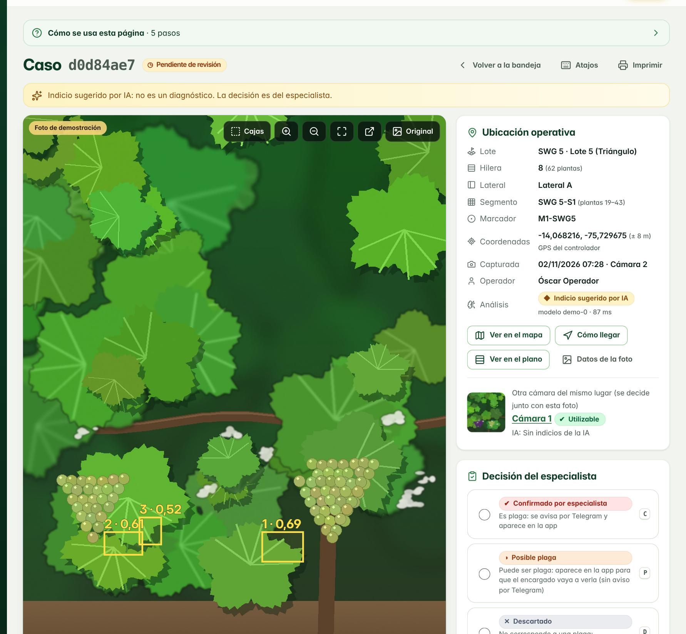

# Revisar un caso



| Dato | Valor |
|---|---|
| Archivo | `03-manuales/media/web/p13-25.jpeg` |
| Documento | Manual de usuario · Plataforma web (v1.6.1) |
| Sección | Revisar y decidir un caso (línea 859 del manual) |
| Tipo | Captura de pantalla de la plataforma web |

## Qué muestra

Ficha de un caso pendiente. A la izquierda la foto con las cajas amarillas de la IA numeradas y su confianza, y herramientas (cajas, zoom, pantalla completa, abrir aparte, original). A la derecha la ubicación operativa, los datos de captura, el análisis, accesos al mapa y al plano, la foto de la otra cámara del mismo lugar y el bloque «Decisión del especialista».

## Texto visible

Cómo se usa esta página · 5 pasos · Caso d0d84ae7 · Pendiente de revisión · Volver a la bandeja · Atajos · Imprimir · Indicio sugerido por IA: no es un diagnóstico. La decisión es del especialista. · Foto de demostración · Cajas · Original · cajas «1 · 0,69», «2 · 0,6…», «3 · 0,52» · Ubicación operativa: Lote SWG 5 · Lote 5 (Triángulo) · Hilera 8 (62 plantas) · Lateral A · Segmento SWG 5-S1 (plantas 19–43) · Marcador M1-SWG5 · Coordenadas -14,068216, -75,729675 (± 8 m) GPS del controlador · Capturada 02/11/2026 07:28 · Cámara 2 · Operador Óscar Operador · Análisis: Indicio sugerido por IA · modelo demo-0 · 87 ms · [Ver en el mapa] [Cómo llegar] [Ver en el plano] [Datos de la foto] · Otra cámara del mismo lugar (se decide junto con esta foto): Cámara 1 · Utilizable · IA: Sin indicios de la IA · Decisión del especialista: Confirmado por especialista (C) · Posible plaga (P) · Descartado (D)

<details><summary>Texto reconocido automáticamente (OCR, sin corregir)</summary>

```text
() Cómo se usa esta página - 5 pasos
Caso d0d84ae7 0 Pendiente de revisión < Volver a la bandeja E) Atajos E Imprimir
+ Indicio sugerido por lA: no es un diagnóstico. La decisión es del especialista.
KE; E Original O Ubicación operativa
Lote SWG 5 : Lote 5 (Triá:
Hilera 8 (62 plantas)
Lateral Lateral A
Segmento SWG 5-S1 (plantas 19-43)
Marcador M1-SWG5
-14,068216, -75,729675 (+ 8 m)
GPS del controlador
Coordenadas
Capturada 02/11/2026 07:28 - Cámara 2
Operador Óscar Operador
. 4 Indicio sugerido por lA
Análi
modelo demo-0 - 87 ms
(U Ver en el mapa </ Cómo llegar
BB Ver enel plano EJ Datos de la foto
Otra cámara del mismo lugar (se decide
junto con esta foto)
Cámara 1 y Utilizable
lA: Sin indicios de la lA
Decisión del especialista
Y Confirmado por especialista
Es plaga: se avisa por Telegram y
» Posible plaga
Pue r a app para
que el en aya a verla (sin aviso
```

</details>
