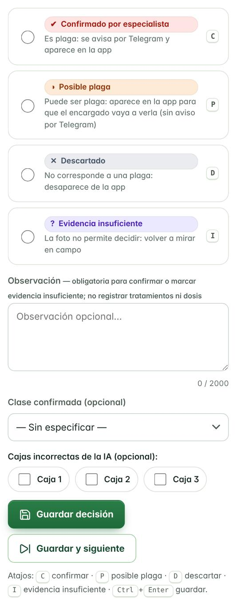

# Decisión del especialista (detalle)



| Dato | Valor |
|---|---|
| Archivo | `03-manuales/media/web/p14-27.jpeg` |
| Documento | Manual de usuario · Plataforma web (v1.6.1) |
| Sección | Decidir paso a paso (línea 943 del manual) |
| Tipo | Captura de pantalla de la plataforma web |

## Qué muestra

Bloque de decisión ampliado: cuatro opciones con su efecto y su tecla de atajo, la observación, la clase confirmada opcional, la marca de cajas incorrectas de la IA y los botones para guardar.

## Texto visible

Confirmado por especialista — Es plaga: se avisa por Telegram y aparece en la app [C] · Posible plaga — Puede ser plaga: aparece en la app para que el encargado vaya a verla (sin aviso por Telegram) [P] · Descartado — No corresponde a una plaga: desaparece de la app [D] · Evidencia insuficiente — La foto no permite decidir: volver a mirar en campo [I] · Observación — obligatoria para confirmar o marcar evidencia insuficiente; no registrar tratamientos ni dosis · [Observación opcional...] 0 / 2000 · Clase confirmada (opcional): — Sin especificar — · Cajas incorrectas de la IA (opcional): ☐ Caja 1 ☐ Caja 2 ☐ Caja 3 · [Guardar decisión] · [Guardar y siguiente] · Atajos: C confirmar · P posible plaga · D descartar · I evidencia insuficiente · Ctrl + Enter guardar.

<details><summary>Texto reconocido automáticamente (OCR, sin corregir)</summary>

```text
Y Confirmado por especialista
'O) Es plaga: se avisa por Telegram y c
aparece en la app
» Posible plaga
O Puede ser plaga: aparece en la app para Pp
que el encargado vaya a verla (sin aviso
por Telegram)
Xx Descartado
O No corresponde a una plaga: D
desaparece de la app
? Evidencia insuficiente
O La foto no permite decidir: volver a mirar 1
en campo
Observación — obligatoria para confirmar o marcar
evidencia insuficiente; no registrar tratamientos ni dosis
Observación opcional...
0/2000
Clase confirmada (opcional)
— Sin especificar — v
Cajas incorrectas de la IA (opcional):
E) caja E) Caja 2 E) Caja 3
(E) Suardar decisión
Dl Guardar y siguiente
Atajos: C confirmar - P posible plaga- D descartar -
I evidencia insuficiente - Ctrl + Enter guardar.
```

</details>
