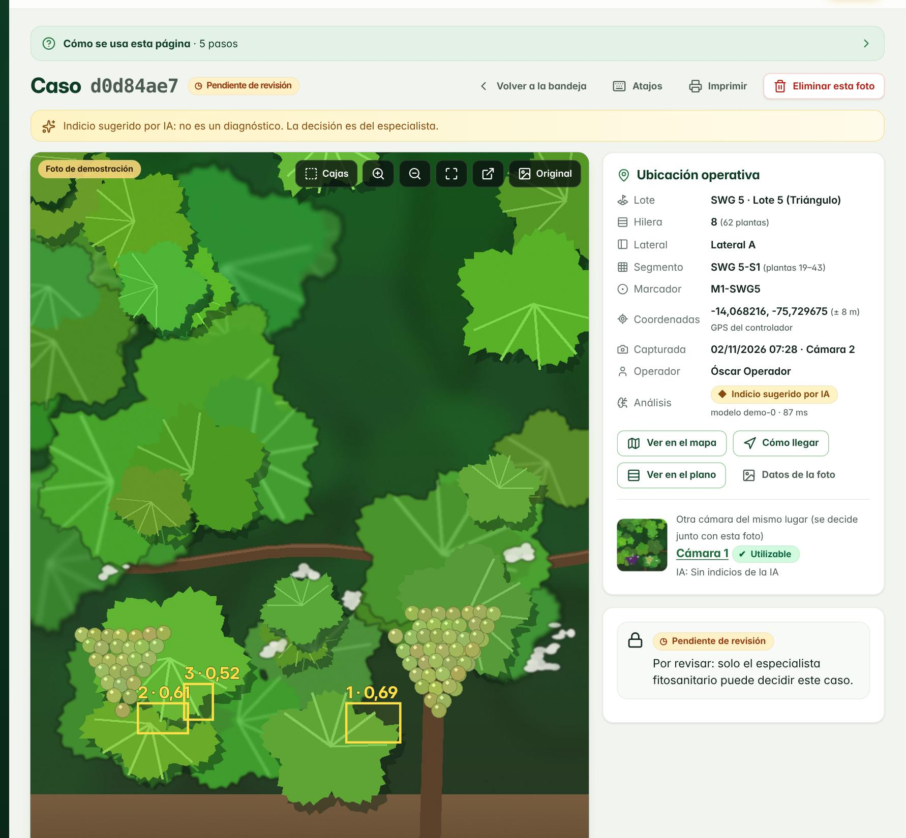

# Caso visto por un usuario sin permiso para decidir



| Dato | Valor |
|---|---|
| Archivo | `03-manuales/media/web/p16-29.jpeg` |
| Documento | Manual de usuario · Plataforma web (v1.6.1) |
| Sección | 4 Lo que ven los demás roles (línea 1025 del manual) |
| Tipo | Captura de pantalla de la plataforma web |

## Qué muestra

La misma ficha de caso, pero el bloque de decisión está bloqueado (candado): solo el especialista fitosanitario puede decidir. Para el administrador aparece «Eliminar esta foto».

## Texto visible

Caso d0d84ae7 · Pendiente de revisión · Volver a la bandeja · Atajos · Imprimir · Eliminar esta foto · (ubicación operativa igual que en el caso) · 🔒 Pendiente de revisión · Por revisar: solo el especialista fitosanitario puede decidir este caso.

<details><summary>Texto reconocido automáticamente (OCR, sin corregir)</summary>

```text
() Cómo se usa esta página - 5 pasos
Caso d0d84ae7 0 Penciente de revisión <- Volver a la bandeja Atajos — (E) Imprimir (Ñ Eliminar esta foto
SF Indicio sugerido por lA: no es un diagnóstico. La decisión es del especialista.
Esto de Gemestración j E; E Original O Ubicación operativa
$ Lote SWG 5 - Lote 5 (Triángulo)
8 Hilera 8 (62 plantas)
Lateral Lateral A
Segmento SWG 5-S1 (plantas 19-43)
(O Marcador M1-SWG5
-14,068216, -75,729675 (+ 8 m)
GPS del controlador
O Coordenadas
(3) Capturada 02/11/2026 07:28 - Cámara 2
2, Operador Óscar Operador
9 Indicio sugerido por lA
A Análisis
modelo demo-0 - 87 ms
(Y Ver en el mapa </ Cómo llegar
BB Ver enel plano EJ Datos de la foto
Otra cámara del mismo lugar (se decide
junto con esta foto)
Cámara 1 y Utilizable
IA: Sin indicios de la lA
a] (O Pendiente de revisión
Por revisar: solo el especialista
fitosanitario puede decidir este caso.
```

</details>
