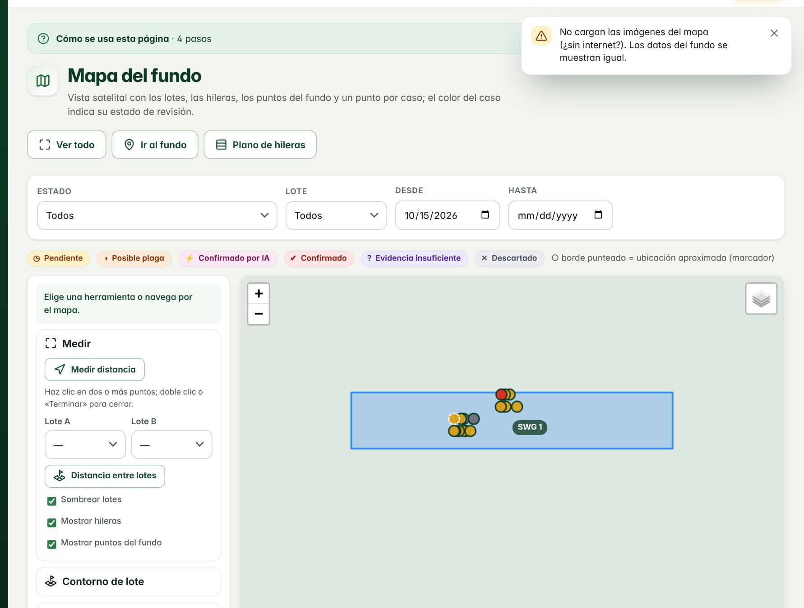

# Mapa del fundo



| Dato | Valor |
|---|---|
| Archivo | `03-manuales/media/web/p18-35.jpeg` |
| Documento | Manual de usuario · Plataforma web (v1.6.1) |
| Sección | Mapa y plano de hileras (línea 1127 del manual) |
| Tipo | Captura de pantalla de la plataforma web |

## Qué muestra

Mapa satelital del fundo. En la imagen las teselas no cargaron (aviso arriba a la derecha) y solo se ven el contorno del lote SWG 1 y los puntos de casos. A la izquierda el panel de herramientas: medir distancia, distancia entre lotes y capas.

## Texto visible

Cómo se usa esta página · 4 pasos · Mapa del fundo · Vista satelital con los lotes, las hileras, los puntos del fundo y un punto por caso; el color del caso indica su estado de revisión. · [Ver todo] [Ir al fundo] [Plano de hileras] · ESTADO Todos · LOTE Todos · DESDE 10/15/2026 · HASTA · Leyenda: Pendiente · Posible plaga · Confirmado por IA · Confirmado · Evidencia insuficiente · Descartado · ○ borde punteado = ubicación aproximada (marcador) · Elige una herramienta o navega por el mapa. · Medir · [Medir distancia] · Haz clic en dos o más puntos; doble clic o «Terminar» para cerrar. · Lote A · Lote B · [Distancia entre lotes] · ☑ Sombrear lotes · ☑ Mostrar hileras · ☑ Mostrar puntos del fundo · Contorno de lote · Aviso: No cargan las imágenes del mapa (¿sin internet?). Los datos del fundo se muestran igual.

<details><summary>Texto reconocido automáticamente (OCR, sin corregir)</summary>

```text
P Ani No cargan las imágenes del mapa Xx
(e 4 4 Aa ec
O O (¿sin internet?). Los datos del fundo se
muestran igual.
a Mapa del fundo
Vista satelital con los lotes, las hileras, los puntos del fundo y un punto por caso; el color del caso
indica su estado de revisión.
3 Vertodo O) Iral fundo E Plano de hileras
ESTADO LOTE DESDE HASTA
Todos v Todos Y 10/15/2026 B mm/dd/yyyy O
(O Pendiente » Posible plaga 2 Confirmado por lA Y Confirmado ? Evidencia insuficiente X Descartado O borde punteado = ubicación aproximada (marcador)
i i +
Elige una herramienta o navega por =Y
el mapa. =
¿3 Medir
J Medir distancia
Haz clic en dos o más puntos; doble clic o
«Terminar» para cerrar.
Lote A Lote B o 'SWG 1
<b Distancia entre lotes
Sombrear lotes
Mostrar hileras
Mostrar puntos del fundo
< Contorno de lote
```

</details>
