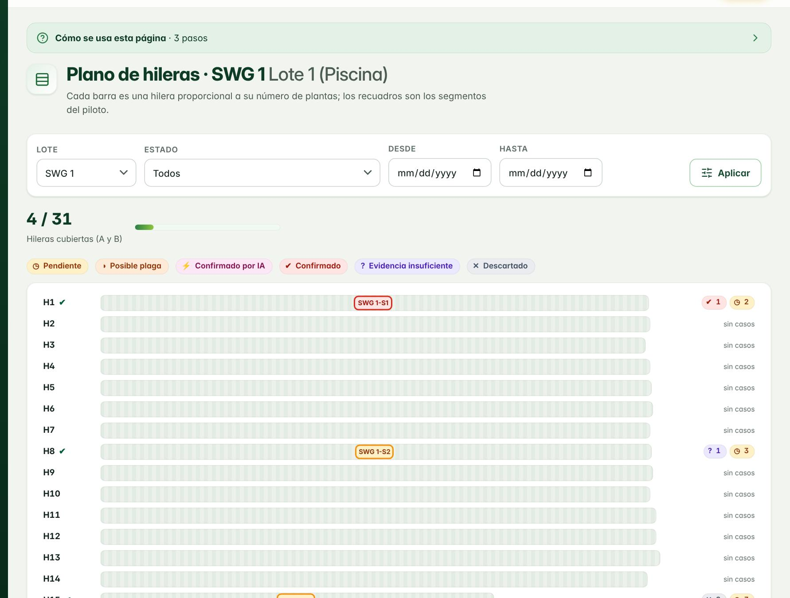

# Plano de hileras



| Dato | Valor |
|---|---|
| Archivo | `03-manuales/media/web/p19-37.jpeg` |
| Documento | Manual de usuario · Plataforma web (v1.6.1) |
| Sección | Plano de hileras (línea 1185 del manual) |
| Tipo | Captura de pantalla de la plataforma web |

## Qué muestra

Plano esquemático de un lote: cada hilera es una barra proporcional a su número de plantas y los recuadros son los segmentos con casos, coloreados por estado. A la derecha el resumen de casos por hilera.

## Texto visible

Cómo se usa esta página · 3 pasos · Plano de hileras · SWG 1 Lote 1 (Piscina) · Cada barra es una hilera proporcional a su número de plantas; los recuadros son los segmentos del piloto. · LOTE SWG 1 · ESTADO Todos · DESDE · HASTA · [Aplicar] · 4 / 31 Hileras cubiertas (A y B) · Leyenda: Pendiente · Posible plaga · Confirmado por IA · Confirmado · Evidencia insuficiente · Descartado · H1 ✓ [SWG1-S1] ✓1 ◷2 · H2 … H7 sin casos · H8 ✓ [SWG1-S2] ?1 ◷3 · H9 … H14 sin casos

<details><summary>Texto reconocido automáticamente (OCR, sin corregir)</summary>

```text
() Cómo se usa esta página - 3 pasos
es Plano de hileras - SWG 1Lote 1 (Piscina)
Cada barra es una hilera proporcional a su número de plantas; los recuadros son los segmentos
del piloto.
LOTE ESTADO
SWG 1 v Todos
4/31
Hileras cubiertas (A y B)
(O Pendiente » Posible plaga 2 Confirmado por IA
H1 y
H8 y
H10
H11
H12
H13
H14
Y Confirmado
DESDE
ES mm/dd/yyyy
? Evidencia insuficiente
HASTA
[m] mm/dd/yyyy
Xx Descartado
3% Aplicar
o 2
sin casos
sin casos
sin casos
sin casos
sin casos
sin casos
sin casos
sin casos
sin casos
sin casos
sin casos
sin casos
```

</details>
