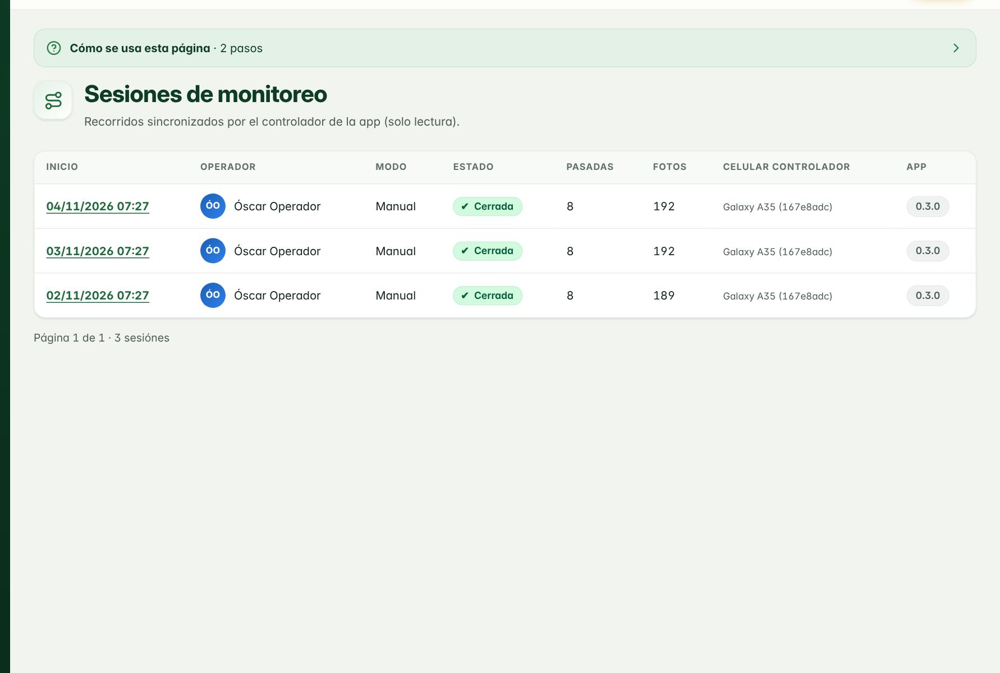

# Sesiones de monitoreo



| Dato | Valor |
|---|---|
| Archivo | `03-manuales/media/web/p20-40.jpeg` |
| Documento | Manual de usuario · Plataforma web (v1.6.1) |
| Sección | Sesiones y fotos (línea 1227 del manual) |
| Tipo | Captura de pantalla de la plataforma web |

## Qué muestra

Lista de sesiones sincronizadas desde el controlador de la app (solo lectura), con operador, modo, estado, número de pasadas y fotos, celular controlador y versión de la app.

## Texto visible

Cómo se usa esta página · 2 pasos · Sesiones de monitoreo · Recorridos sincronizados por el controlador de la app (solo lectura). · Columnas: INICIO · OPERADOR · MODO · ESTADO · PASADAS · FOTOS · CELULAR CONTROLADOR · APP · 04/11/2026 07:27 · Óscar Operador · Manual · Cerrada · 8 · 192 · Galaxy A35 (167e8adc) · 0.3.0 · 03/11/2026 07:27 · … · 192 · 0.3.0 · 02/11/2026 07:27 · … · 189 · 0.3.0 · Página 1 de 1 · 3 sesiones

<details><summary>Texto reconocido automáticamente (OCR, sin corregir)</summary>

```text
() Cómo se usa esta página - 2 pasos
< Sesiones de monitoreo
Recorridos sincronizados por el controlador de la app (solo lectura).
INICIO OPERADOR
04/11/2026 07:27
03/11/2026 07:27
02/11/2026 07:27
Página 1 de 1 - 3 sesiónes
MODO
Manual
Manual
Manual
ESTADO
Y Cerrada
Y Cerrada
Y Cerrada
PASADAS
FOTOS
192
192
189
CELULAR CONTROLADOR
Galaxy A35 (167e8adc)
Galaxy A35 (167e8adc)
Galaxy A35 (167e8adc)
APP
0.3.0
0.3.0
0.3.0
```

</details>
