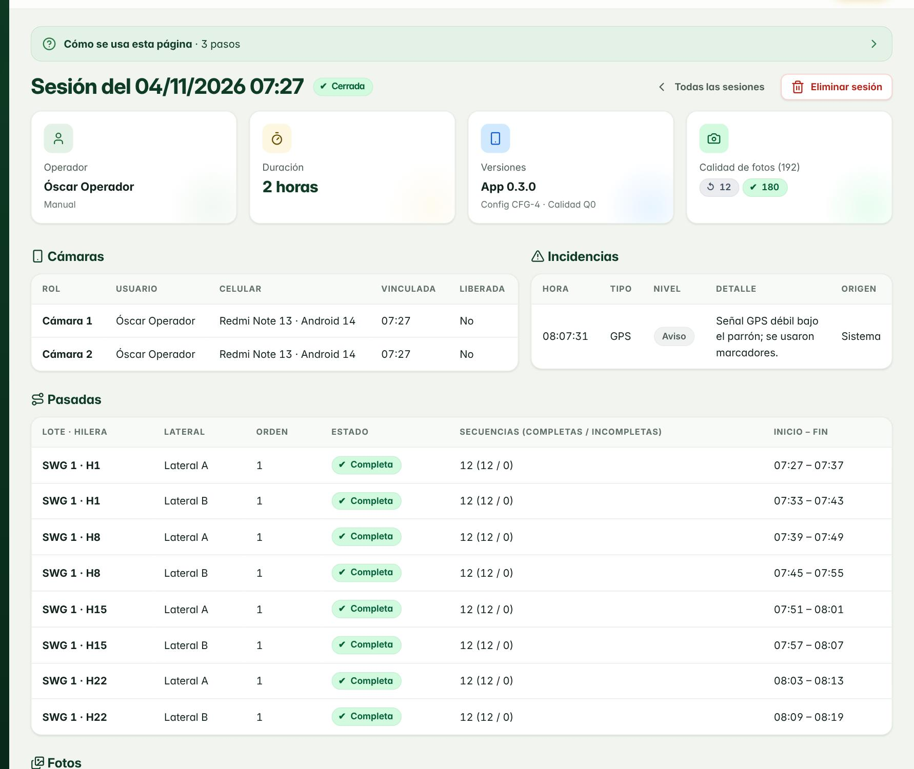

# Detalle de una sesión



| Dato | Valor |
|---|---|
| Archivo | `03-manuales/media/web/p21-42.jpeg` |
| Documento | Manual de usuario · Plataforma web (v1.6.1) |
| Sección | Sesiones y fotos (línea 1259 del manual) |
| Tipo | Captura de pantalla de la plataforma web |

## Qué muestra

Detalle de la sesión del 04/11/2026: tarjetas de operador, duración, versiones y calidad de fotos; tablas de cámaras vinculadas, incidencias y pasadas (lote-hilera, lateral, orden, estado, secuencias e intervalo horario).

## Texto visible

Sesión del 04/11/2026 07:27 · Cerrada · Todas las sesiones · Eliminar sesión · Operador Óscar Operador (Manual) · Duración 2 horas · Versiones App 0.3.0 · Config CFG-4 · Calidad Q0 · Calidad de fotos (192): ↻ 12 · ✓ 180 · Cámaras: ROL · USUARIO · CELULAR · VINCULADA · LIBERADA — Cámara 1 · Óscar Operador · Redmi Note 13 · Android 14 · 07:27 · No — Cámara 2 · igual · Incidencias: HORA 08:07:31 · TIPO GPS · NIVEL Aviso · DETALLE Señal GPS débil bajo el parrón; se usaron marcadores. · ORIGEN Sistema · Pasadas: SWG 1 · H1/H8/H15/H22 · Lateral A y B · orden 1 · Completa · 12 (12 / 0) · 07:27 – 08:19 · Fotos

<details><summary>Texto reconocido automáticamente (OCR, sin corregir)</summary>

```text
() Cómo se usa esta página - 3 pasos
Sesión del 04/11/2026 07:27 + ceras
A [0)
Operador Duración
Óscar Operador 2 horas
Manual
DD Cámaras
ROL USUARIO CELULAR VINCULADA
Cámara 1 Óscar Operador Redmi Note 13 - Android 14 07:27
Cámara 2 Óscar Operador Redmi Note 13 - Android 14 07:27
$ Pasadas
LOTE - HILERA LATERAL ORDEN ESTADO
SWG 1 - H1 Lateral A Ti Y Completa
SWG 1 - H1 Lateral B dl Y Completa
SWG 1 - H8 Lateral A J Y Completa
SWG 1 - H8 Lateral B T Y Completa
SWG 1 -H15 Lateral A 1 Y Completa
SWG 1 -H15 Lateral B 1 Y Completa
SWG 1 - H22 Lateral A J Y Completa
SWG 1 - H22 Lateral B 1 Y Completa
(1 Fotos
[n]
Versiones
App 0.3.0
Config CFG-4 - Calidad QO
A Incidencias
LIBERADA HORA TIPO
08:07:31 GPS
< Todas las sesiones
NIVEL
Aviso
SECUENCIAS (COMPLETAS / INCOMPLETAS)
12 (12/0)
12 (12/0)
12 (12/0)
12 (12/0)
12 (12/0)
12 (12/0)
12 (12/0)
12 (12/0)
Ú] Eliminar sesión
[1]
Calidad de fotos (192)
9 12 Y 180
DETALLE ORIGEN
Señal GPS débil bajo
el parrón; se usaron Sistema
marcadores.
INICIO - FIN
07:27 - 07:37
07:33 - 07:43
07:39 - 07:49
07:45 - 07:55
07:51 - 08:01
07:57 - 08:07
08:03 - 08:13
08:09 - 08:19
```

</details>
