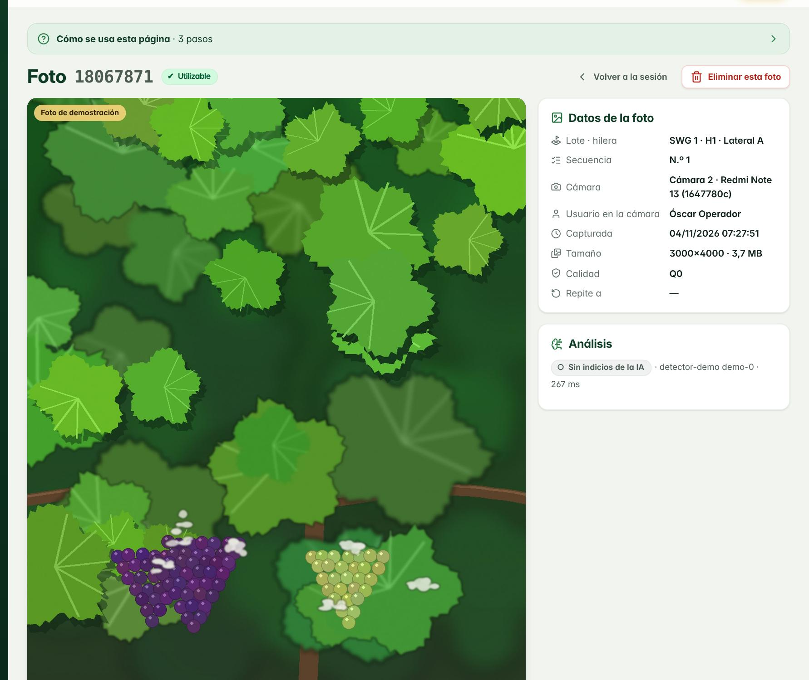

# Detalle de una foto



| Dato | Valor |
|---|---|
| Archivo | `03-manuales/media/web/p22-44.jpeg` |
| Documento | Manual de usuario · Plataforma web (v1.6.1) |
| Sección | Página de una foto (línea 1309 del manual) |
| Tipo | Captura de pantalla de la plataforma web |

## Qué muestra

Ficha de una foto individual: imagen a la izquierda y, a la derecha, los datos de captura (lote, hilera, lateral, secuencia, cámara, usuario, hora, tamaño, calidad) y el resultado del análisis de la IA.

## Texto visible

Foto 18067871 · Utilizable · Volver a la sesión · Eliminar esta foto · Foto de demostración · Datos de la foto: Lote · hilera SWG 1 · H1 · Lateral A · Secuencia N.º 1 · Cámara Cámara 2 · Redmi Note 13 (1647780c) · Usuario en la cámara Óscar Operador · Capturada 04/11/2026 07:27:51 · Tamaño 3000×4000 · 3,7 MB · Calidad Q0 · Repite a — · Análisis: Sin indicios de la IA · detector-demo demo-0 · 267 ms

<details><summary>Texto reconocido automáticamente (OCR, sin corregir)</summary>

```text
() Cómo se usa esta página - 3 pasos
Foto 18067871 + viizobie <- Volver a la sesión [6] Eliminar esta foto
13 Datos de la foto
Lote - hilera SWG 1- HI: Lateral A
= Secuencia N.91
Cámara Cámara 2 - Redmi Note
13 (1647780c)
Usuario en la cámara Óscar Operador
Capturada 04/11/2026 07:27:51
(13 Tamaño 3000x4000 - 3,7 MB
Calidad [elo]
Repite a -
0% Análisis
O Sin indicios de la lA detector-demo demo-0
267 ms
```

</details>
