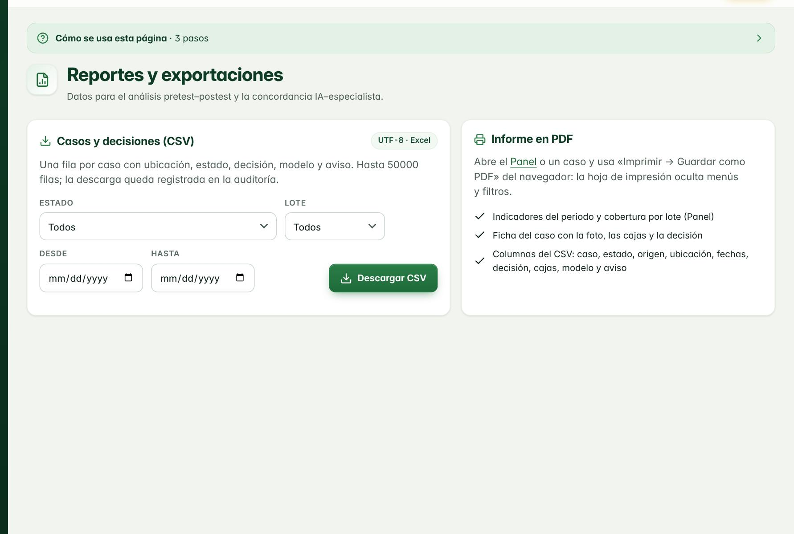

# Reportes y exportaciones



| Dato | Valor |
|---|---|
| Archivo | `03-manuales/media/web/p23-47.jpeg` |
| Documento | Manual de usuario · Plataforma web (v1.6.1) |
| Sección | Reportes (línea 1361 del manual) |
| Tipo | Captura de pantalla de la plataforma web |

## Qué muestra

Pantalla de reportes: descarga del CSV de casos y decisiones con filtros y explicación de cómo obtener el informe en PDF imprimiendo desde el navegador.

## Texto visible

Cómo se usa esta página · 3 pasos · Reportes y exportaciones · Datos para el análisis pretest–postest y la concordancia IA–especialista. · Casos y decisiones (CSV) · UTF-8 · Excel · Una fila por caso con ubicación, estado, decisión, modelo y aviso. Hasta 50000 filas; la descarga queda registrada en la auditoría. · ESTADO Todos · LOTE Todos · DESDE · HASTA · [Descargar CSV] · Informe en PDF · Abre el Panel o un caso y usa «Imprimir → Guardar como PDF» del navegador: la hoja de impresión oculta menús y filtros. · ✓ Indicadores del periodo y cobertura por lote (Panel) · ✓ Ficha del caso con la foto, las cajas y la decisión · ✓ Columnas del CSV: caso, estado, origen, ubicación, fechas, decisión, cajas, modelo y aviso

<details><summary>Texto reconocido automáticamente (OCR, sin corregir)</summary>

```text
() Cómo se usa esta página - 3 pasos
(y Reportes y exportaciones
Datos para el análisis pretest-postest y la concordancia lA-especialista.
Y, Casos y decisiones (CSV)
UTF-8 - Excel
Una fila por caso con ubicación, estado, decisión, modelo y aviso. Hasta 50000
filas; la descarga queda registrada en la auditoría.
ESTADO LOTE
Todos há Todos
DESDE HASTA
mm/dd/yyyy O mm/dd/yyyy O
Y, Descargar CSV
( Informe en PDF
Abre el Panel o un caso y usa «Imprimir > Guardar como
PDF» del navegador: la hoja de impresión oculta menús
y filtros.
Y Indicadores del periodo y cobertura por lote (Panel)
Y Ficha del caso con la foto, las cajas y la decisión
Columnas del CSV: caso, estado, origen, ubicación, fechas,
decisión, cajas, modelo y aviso
```

</details>
