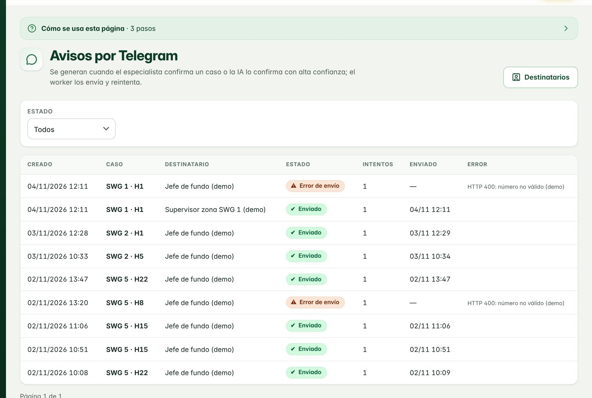

# Avisos por Telegram



| Dato | Valor |
|---|---|
| Archivo | `03-manuales/media/web/p24-50.jpeg` |
| Documento | Manual de usuario · Plataforma web (v1.6.1) |
| Sección | Avisos por Telegram (línea 1431 del manual) |
| Tipo | Captura de pantalla de la plataforma web |

## Qué muestra

Registro de avisos generados: fecha, caso, destinatario, estado (Enviado o Error de envío), intentos, hora de envío y error. Los dos errores del ejemplo son números no válidos del entorno de demostración.

## Texto visible

Cómo se usa esta página · 3 pasos · Avisos por Telegram · Se generan cuando el especialista confirma un caso o la IA lo confirma con alta confianza; el worker los envía y reintenta. · [Destinatarios] · ESTADO Todos · Columnas: CREADO · CASO · DESTINATARIO · ESTADO · INTENTOS · ENVIADO · ERROR · 04/11/2026 12:11 · SWG 1 · H1 · Jefe de fundo (demo) · Error de envío · 1 · — · HTTP 400: número no válido (demo) · 04/11/2026 12:11 · SWG 1 · H1 · Supervisor zona SWG 1 (demo) · Enviado · 1 · 04/11 12:11 · (siguen 7 filas Enviado y 1 Error de envío de SWG 2 y SWG 5) · Página 1 de 1

<details><summary>Texto reconocido automáticamente (OCR, sin corregir)</summary>

```text
() Cómo se usa esta página - 3 pasos
oO A
worker los envía y reintenta.
ESTADO
Todos
CREADO
04/11/2026 12:11
04/11/2026 12:11
03/11/2026 12:28
03/11/2026 10:33
02/11/2026 13:47
02/11/2026 13:20
02/11/2026 11:06
02/11/2026 10:51
02/11/2026 10:08
Página 1 de 1
cASso
SWG 1 -
SWG 1 -
SwG 2 -
SwG 2-
SWG5-
SWG5-
SWG5-
SWG5-
SWG 5:
H22
H15
H15
H22
sos por Telegram
Se generan cuando el especialista confirma un caso o la lA lo confirma con alta confianza; el
DESTINATARIO
Jefe de fundo (demo)
Supervisor zona SWG 1 (demo)
Jefe de fundo (demo)
Jefe de fundo (demo)
Jefe de fundo (demo)
Jefe de fundo (demo)
Jefe de fundo (demo)
Jefe de fundo (demo)
Jefe de fundo (demo)
ESTADO
A Error de envío
Y Enviado
Y Enviado
Y Enviado
Y Enviado
A Error de envío
Y Enviado
Y Enviado
Y Enviado
INTENTOS
ENVIADO
04/11 12:11
03/11 12:29
03/11 10:34
02/11 13:47
02/11 11:06
02/11 10:51
02/11 10:09
[E] Destinatarios
ERROR
HTTP 400: número no válido (demo)
HTTP 400: número no válido (demo)
```

</details>
