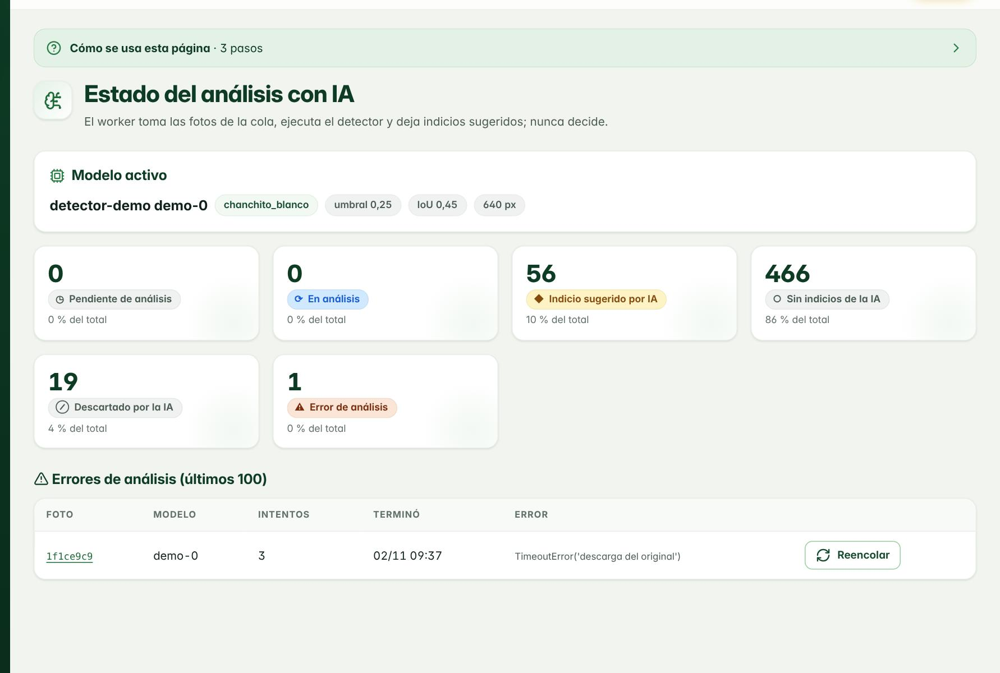

# Estado del análisis con IA



| Dato | Valor |
|---|---|
| Archivo | `03-manuales/media/web/p26-55.jpeg` |
| Documento | Manual de usuario · Plataforma web (v1.6.1) |
| Sección | Estado de la IA (línea 1537 del manual) |
| Tipo | Captura de pantalla de la plataforma web |

## Qué muestra

Estado del worker de IA: el modelo activo con sus parámetros, contadores por resultado de análisis y la tabla de errores recientes con el botón «Reencolar».

## Texto visible

Cómo se usa esta página · 3 pasos · Estado del análisis con IA · El worker toma las fotos de la cola, ejecuta el detector y deja indicios sugeridos; nunca decide. · Modelo activo: detector-demo demo-0 · chanchito_blanco · umbral 0,25 · IoU 0,45 · 640 px · 0 Pendiente de análisis (0 %) · 0 En análisis (0 %) · 56 Indicio sugerido por IA (10 %) · 466 Sin indicios de la IA (86 %) · 19 Descartado por la IA (4 %) · 1 Error de análisis (0 %) · Errores de análisis (últimos 100): FOTO 1f1ce9c9 · MODELO demo-0 · INTENTOS 3 · TERMINÓ 02/11 09:37 · ERROR TimeoutError('descarga del original') · [Reencolar]

<details><summary>Texto reconocido automáticamente (OCR, sin corregir)</summary>

```text
() Cómo se usa esta página - 3 pasos
es Estado del análisis con lA
El worker toma las fotos de la cola, ejecuta el detector y deja indicios sugeridos; nunca decide.
10) Modelo activo
detector-demo demo-0  chanchito_blanco umbral 0,25 10U 0,45
0 0
GO Pendiente de análisis € En análisis
0 % del total 0 % del total
Descartado por la lA A Error de análisis
O p
4 % del total 0 % del total
A Errores de análisis (últimos 100)
FOTO MODELO INTENTOS TERMINÓ
1f1lce9c9 demo-0 3 02/11 09:37
4 Indicio sugerido por lA
10 % del total
ERROR
TimeoutError('descarga del original")
466
O Sin indicios de la lA
86 % del total
(O Reencolar
```

</details>
