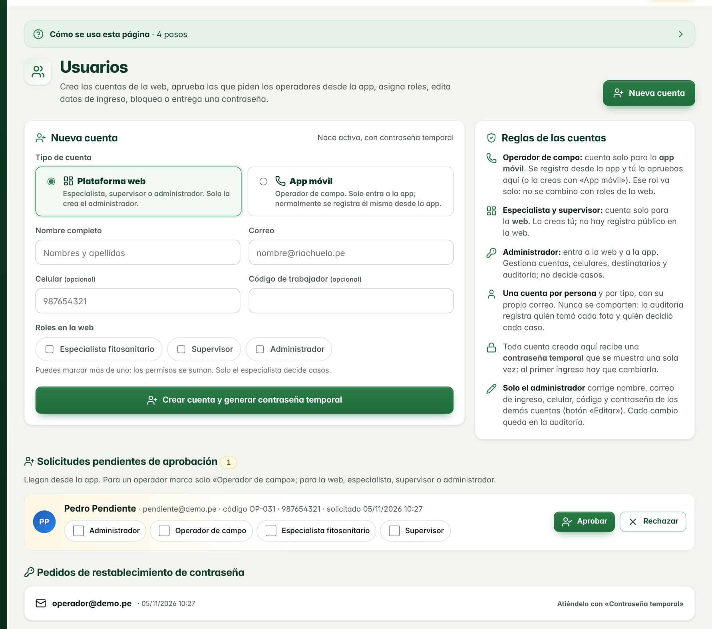

# Usuarios



| Dato | Valor |
|---|---|
| Archivo | `03-manuales/media/web/p28-58.jpeg` |
| Documento | Manual de usuario · Plataforma web (v1.6.1) |
| Sección | Usuarios y celulares (línea 1619 del manual) |
| Tipo | Captura de pantalla de la plataforma web |

## Qué muestra

Administración de cuentas: formulario para crear una cuenta web o de app con roles, panel con las reglas de las cuentas, solicitudes pendientes que llegan desde la app (aprobar o rechazar asignando rol) y pedidos de restablecimiento de contraseña.

## Texto visible

Cómo se usa esta página · 4 pasos · Usuarios · Crea las cuentas de la web, aprueba las que piden los operadores desde la app, asigna roles, edita datos de ingreso, bloquea o entrega una contraseña. · [Nueva cuenta] · Nueva cuenta (Nace activa, con contraseña temporal) · Tipo de cuenta: ◉ Plataforma web — Especialista, supervisor o administrador. Solo la crea el administrador. ○ App móvil — Operador de campo. Solo entra a la app; normalmente se registra él mismo desde la app. · Nombre completo · Correo · Celular (opcional) · Código de trabajador (opcional) · Roles en la web: ☐ Especialista fitosanitario ☐ Supervisor ☐ Administrador · Puedes marcar más de uno: los permisos se suman. Solo el especialista decide casos. · [Crear cuenta y generar contraseña temporal] · Reglas de las cuentas: Operador de campo (solo app) · Especialista y supervisor (solo web) · Administrador (web y app; no decide casos) · Una cuenta por persona · contraseña temporal de un solo uso · Solo el administrador corrige datos de otros; cada cambio queda en la auditoría · Solicitudes pendientes de aprobación (1): Pedro Pendiente · pendiente@demo.pe · código OP-031 · solicitado 05/11/2026 10:27 · ☐ Administrador ☐ Operador de campo ☐ Especialista fitosanitario ☐ Supervisor · [Aprobar] [Rechazar] · Pedidos de restablecimiento de contraseña: operador@demo.pe · 05/11/2026 10:27 · Atiéndelo con «Contraseña temporal»

<details><summary>Texto reconocido automáticamente (OCR, sin corregir)</summary>

```text
() Cómo se usa esta página - 4 pasos
> Usuarios
Crea las cuentas de la web, aprueba las que piden los operadores desde la app, asigna roles, edita
datos de ingreso, bloquea o entrega una contraseña.
2+ Nueva cuenta
Tipo de cuenta
(O 25 Plataforma web
Especialista, supervisor o administrador. Solo la
crea el administrador.
Nombre completo
Nombres y apellidos
Celular (opcional)
[teléfono omitido]
Roles en la web
O Especialista fitosanitario
O Supervisor
Nace activa, con contraseña temporal
O K App móvil
Operador de campo. Solo entra a la app;
normalmente se registra él mismo desde la app.
Correo
nombreGOriachuelo.pe
Código de trabajador (opcional)
OD Administrador
Puedes marcar más de uno: los permisos se suman. Solo el especialista decide casos.
2£+ Nueva cuenta
Y Reglas de las cuentas
y Operador de campo: cuenta solo para la app
móvil. Se registra desde la app y tú la apruebas
aquí (o la creas con «App móvil»). Ese rol va
solo: no se combina con roles de la web.
05 Especialista y supervisor: cuenta solo para
la web. La creas tú; no hay registro público en
la web.
Pe) Administrador: entra a la web y a la app.
Gestiona cuentas, celulares, destinatarios y
auditoría; no decide casos.
Una cuenta por persona y por tipo, con su
propio correo. Nunca se comparten: la auditoría
registra quién tomó cada foto y quién decidió
cada caso.
ao Toda cuenta creada aquí recibe una
contraseña temporal que se muestra una sola
vez; al primer ingreso hay que cambiarla.
Pé Solo el administrador corrige nombre, correo
de ingreso, celular, código y contraseña de las
2+ Crear cuenta y generar contraseña temporal
2* Solicitudes pendientes de aprobación 1
demás cuentas (botón «Editar»). Cada cambio
queda en la auditoría.
Llegan desde la app. Para un operador marca solo «Operador de campo»; para la web, especialista, supervisor o administrador.
Pedro Pendiente - pendienteAdemo.pe - código OP-031 - [teléfono omitido] - solicitado 05/11/2026 10:27
O Administrador
O Operador de campo ) Especialista fitosanitario O Supervisor
¿2 Pedidos de restablecimiento de contraseña
E operadorOdemo.pe - 05/11/2026 10:27 Atiéndelo con «Contraseña temporal»
```

</details>
