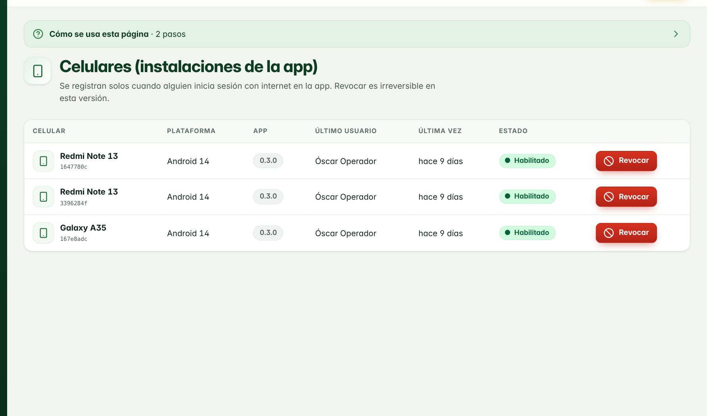

# Celulares (instalaciones de la app)



| Dato | Valor |
|---|---|
| Archivo | `03-manuales/media/web/p29-60.jpeg` |
| Documento | Manual de usuario · Plataforma web (v1.6.1) |
| Sección | Celulares (línea 1689 del manual) |
| Tipo | Captura de pantalla de la plataforma web |

## Qué muestra

Lista de celulares donde se instaló e inició sesión la app: modelo e identificador corto, plataforma, versión, último usuario, última vez y estado, con el botón rojo «Revocar» (irreversible para esa versión).

## Texto visible

Cómo se usa esta página · 2 pasos · Celulares (instalaciones de la app) · Se registran solos cuando alguien inicia sesión con internet en la app. Revocar es irreversible en esta versión. · Columnas: CELULAR · PLATAFORMA · APP · ÚLTIMO USUARIO · ÚLTIMA VEZ · ESTADO · Redmi Note 13 · Android 14 · 0.3.0 · Óscar Operador · hace 9 días · Habilitado · [Revocar] · Redmi Note 13 · … · Galaxy A35 · … · Habilitado · [Revocar]

<details><summary>Texto reconocido automáticamente (OCR, sin corregir)</summary>

```text
() Cómo se usa esta página - 2 pasos
o Celulares (instalaciones de la app)
Se registran solos cuando alguien inicia sesión con internet en la app. Revocar es irreversible en
esta versión.
CELULAR PLATAFORMA APP ÚLTIMO USUARIO ÚLTIMA VEZ ESTADO
Redmi Note 13
164780 Android 14 0.3.0 Óscar Operador hace 9 días O Habilitado (O Revocar
Redmi Note 13
so6inAf Android 14 0.3.0 Óscar Operador hace 9 días 0 Habilitado O Revocar
Galaxy A35
tévóñide Android 14 0.3.0 Óscar Operador hace 9 días O Habilitado (O Revocar
```

</details>
