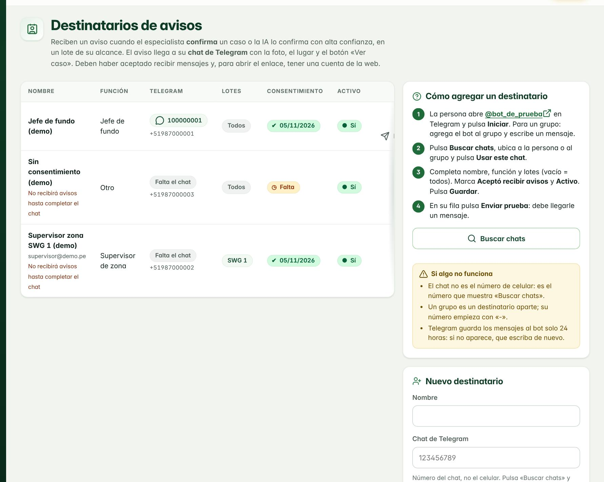

# Destinatarios de avisos



| Dato | Valor |
|---|---|
| Archivo | `03-manuales/media/web/p31-63.jpeg` |
| Documento | Manual de usuario · Plataforma web (v1.6.1) |
| Sección | Destinatarios de avisos (línea 1751 del manual) |
| Tipo | Captura de pantalla de la plataforma web |

## Qué muestra

Lista de personas o grupos de Telegram que reciben los avisos: función, chat, lotes, consentimiento y estado. Dos destinatarios de ejemplo aún no reciben avisos (falta el chat o el consentimiento). A la derecha, la guía para agregar uno y el formulario «Nuevo destinatario».

## Texto visible

Destinatarios de avisos · Reciben un aviso cuando el especialista confirma un caso o la IA lo confirma con alta confianza, en un lote de su alcance. El aviso llega a su chat de Telegram con la foto, el lugar y el botón «Ver caso». Deben haber aceptado recibir mensajes y, para abrir el enlace, tener una cuenta de la web. · Columnas: NOMBRE · FUNCIÓN · TELEGRAM · LOTES · CONSENTIMIENTO · ACTIVO · Jefe de fundo (demo) · Jefe de fundo · 100000001 · Todos · ✓ 05/11/2026 · Sí · Sin consentimiento (demo) · Otro · Falta el chat · Todos · Falta · Sí · «No recibirá avisos hasta completar el chat» · Supervisor zona SWG 1 (demo) · Supervisor de zona · Falta el chat · SWG 1 · ✓ 05/11/2026 · Sí · Cómo agregar un destinatario (4 pasos) · [Buscar chats] · Si algo no funciona · Nuevo destinatario

<details><summary>Texto reconocido automáticamente (OCR, sin corregir)</summary>

```text
Destinatarios de avisos
Reciben un aviso cuando el especialista confirma un caso o la lA lo confirma con alta confianza, en
un lote de su alcance. El aviso llega a su chat de Telegram con la foto, el lugar y el botón «Ver
caso». Deben haber aceptado recibir mensajes y, para abrir el enlace, tener una cuenta de la web.
NOMBRE
Jefe de fundo
(demo)
Sin
consentimiento
(demo)
No recibirá avisos
hasta completar el
chat
Supervisor zona
SWG 1 (demo)
supervisorOdemo.pe
No recibirá avisos
hasta completar el
chat
FUNCIÓN
Jefe de
fundo
Otro
Supervisor
de zona
TELEGRAM LOTES
[O 100000001
Todos
+51987000001
Falta el chat
Todos
+51987000003
Falta el chat
SWG 1
+51987000002
CONSENTIMIENTO
Y 05/11/2026
O Falta
Y 05/11/2026
ACTIVO
O Sí
O Sí
O Sí
( Cómo agregar un destinatario
O La persona abre Obot_de_pruebalÍ en
Telegram y pulsa Iniciar. Para un grupo:
agrega el bot al grupo y escribe un mensaje.
O Pulsa Buscar chats, ubica a la persona o al
grupo y pulsa Usar este chat.
(5) Completa nombre, función y lotes (vacío =
todos). Marca Aceptó recibir avisos y Activo.
Pulsa Guardar.
[4] En su fila pulsa Enviar prueba: debe llegarle
un mensaje.
Q Buscar chats
A% Si algo no funciona
+ El chat no es el número de celular: es el
número que muestra «Buscar chats».
+ Un grupo es un destinatario aparte; su
número empieza con «-».
+ Telegram guarda los mensajes al bot solo 24
horas: si no aparece, que escriba de nuevo.
2+ Nuevo destinatario
Nombre
Chat de Telegram
123456789
Número del chat, no el celular. Pulsa «Buscar chats» y
```

</details>
