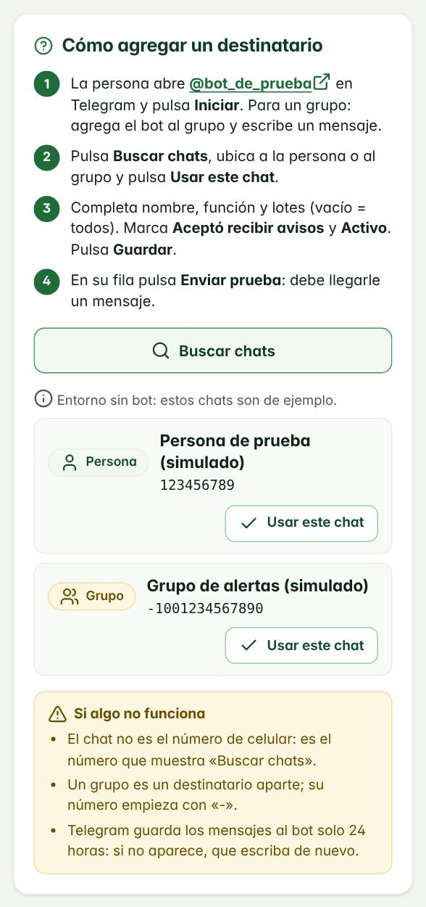

# Cómo agregar un destinatario y Buscar chats



| Dato | Valor |
|---|---|
| Archivo | `03-manuales/media/web/p32-65.jpeg` |
| Documento | Manual de usuario · Plataforma web (v1.6.1) |
| Sección | Destinatarios de avisos (línea 1837 del manual) |
| Tipo | Captura de pantalla de la plataforma web |

## Qué muestra

Panel lateral ampliado: los cuatro pasos para dar de alta a alguien en Telegram y el resultado de «Buscar chats». En este entorno no hay bot real, por eso los chats son simulados (una persona y un grupo).

## Texto visible

Cómo agregar un destinatario · 1 La persona abre @bot_de_prueba en Telegram y pulsa Iniciar. Para un grupo: agrega el bot al grupo y escribe un mensaje. · 2 Pulsa Buscar chats, ubica a la persona o al grupo y pulsa Usar este chat. · 3 Completa nombre, función y lotes (vacío = todos). Marca Aceptó recibir avisos y Activo. Pulsa Guardar. · 4 En su fila pulsa Enviar prueba: debe llegarle un mensaje. · [Buscar chats] · ⓘ Entorno sin bot: estos chats son de ejemplo. · Persona — Persona de prueba (simulado) · 123456789 · [Usar este chat] · Grupo — Grupo de alertas (simulado) · -1001234567890 · [Usar este chat] · Si algo no funciona: El chat no es el número de celular: es el número que muestra «Buscar chats». · Un grupo es un destinatario aparte; su número empieza con «-». · Telegram guarda los mensajes al bot solo 24 horas: si no aparece, que escriba de nuevo.

<details><summary>Texto reconocido automáticamente (OCR, sin corregir)</summary>

```text
( Cómo agregar un destinatario
(1) La persona abre Qbot_de_pruebalÍ en
Telegram y pulsa Iniciar. Para un grupo:
agrega el bot al grupo y escribe un mensaje.
[2] Pulsa Buscar chats, ubica a la persona o al
grupo y pulsa Usar este chat.
(3) Completa nombre, función y lotes (vacío =
todos). Marca Aceptó recibir avisos y Activo.
Pulsa Guardar.
[4] En su fila pulsa Enviar prueba: debe llegarle
un mensaje.
Q Buscar chats
(0) Entorno sin bot: estos chats son de ejemplo.
Persona de prueba
2, Persona (simulado)
123456789
Y Usar este chat
Grupo de alertas (simulado)
2 Grupo
paa -1001234567890
Y Usar este chat
A Si algo no funciona
+ El chat no es el número de celular: es el
número que muestra «Buscar chats».
+ Un grupo es un destinatario aparte; su
número empieza con «-».
+ Telegram guarda los mensajes al bot solo 24
horas: si no aparece, que escriba de nuevo.
```

</details>
