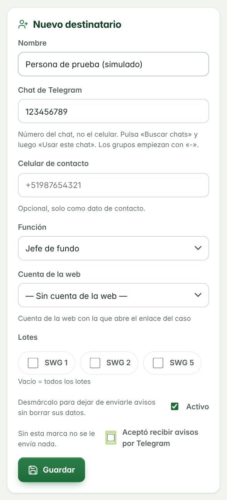

# Nuevo destinatario (formulario)



| Dato | Valor |
|---|---|
| Archivo | `03-manuales/media/web/p32-67.jpeg` |
| Documento | Manual de usuario · Plataforma web (v1.6.1) |
| Sección | Destinatarios de avisos (línea 1847 del manual) |
| Tipo | Captura de pantalla de la plataforma web |

## Qué muestra

Formulario de alta llenado con el chat simulado. La casilla «Aceptó recibir avisos por Telegram» aún está sin marcar: sin ella no se le envía nada.

## Texto visible

Nuevo destinatario · Nombre [Persona de prueba (simulado)] · Chat de Telegram [123456789] · Número del chat, no el celular. Pulsa «Buscar chats» y luego «Usar este chat». Los grupos empiezan con «-». · Celular de contacto [+51987654321] · Opcional, solo como dato de contacto. · Función [Jefe de fundo] · Cuenta de la web [— Sin cuenta de la web —] · Cuenta de la web con la que abre el enlace del caso · Lotes ☐ SWG 1 ☐ SWG 2 ☐ SWG 5 · Vacío = todos los lotes · Desmárcalo para dejar de enviarle avisos sin borrar sus datos. ☑ Activo · Sin esta marca no se le envía nada. ☐ Aceptó recibir avisos por Telegram · [Guardar]

<details><summary>Texto reconocido automáticamente (OCR, sin corregir)</summary>

```text
2 Nuevo destinatario
Nombre
Persona de prueba (simulado)
Chat de Telegram
123456789
Número del chat, no el celular. Pulsa «Buscar chats» y
luego «Usar este chat». Los grupos empiezan con «-».
Celular de contacto
+51987654321
Opcional, solo como dato de contacto.
Función
Jefe de fundo v
Cuenta de la web
— Sin cuenta de la web — Y
Cuenta de la web con la que abre el enlace del caso
Lotes
[JJ swG1 FJ sw62 LJ sw65
Vacío = todos los lotes
Desmárcalo para dejar de enviarle avisos
Activo
sin borrar sus datos.
Sin esta marca no se le 6 Aceptó recibir avisos
envía nada. por Telegram
```

</details>
