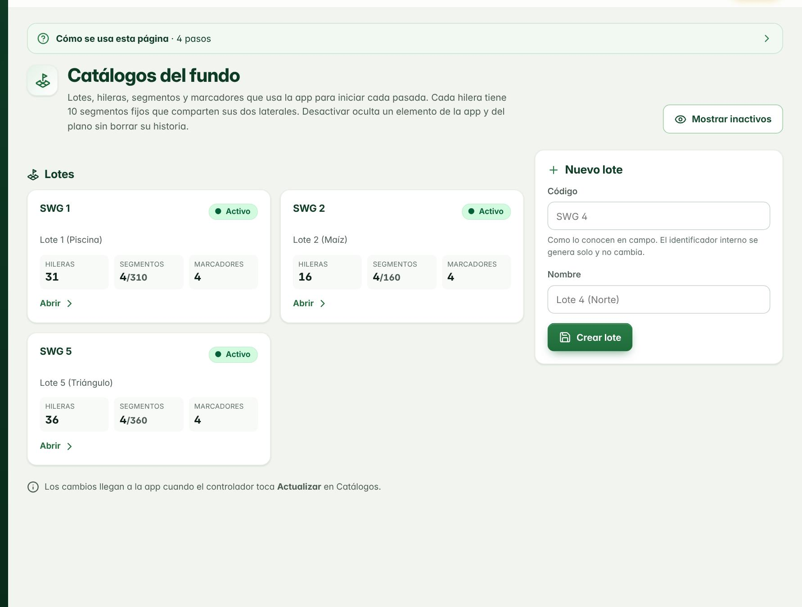

# Catálogos del fundo (lotes)



| Dato | Valor |
|---|---|
| Archivo | `03-manuales/media/web/p34-70.jpeg` |
| Documento | Manual de usuario · Plataforma web (v1.6.1) |
| Sección | Catálogos del fundo (línea 1925 del manual) |
| Tipo | Captura de pantalla de la plataforma web |

## Qué muestra

Lista de lotes del fundo con su conteo de hileras, segmentos y marcadores, y el formulario para crear un lote nuevo. Avisa que los cambios llegan a la app cuando el controlador pulsa «Actualizar» en Catálogos.

## Texto visible

Cómo se usa esta página · 4 pasos · Catálogos del fundo · Lotes, hileras, segmentos y marcadores que usa la app para iniciar cada pasada. Cada hilera tiene 10 segmentos fijos que comparten sus dos laterales. Desactivar oculta un elemento de la app y del plano sin borrar su historia. · [Mostrar inactivos] · Lotes: SWG 1 · Activo · Lote 1 (Piscina) · HILERAS 31 · SEGMENTOS 4/310 · MARCADORES 4 · Abrir · SWG 2 · Lote 2 (Maíz) · 16 · 4/160 · 4 · SWG 5 · Lote 5 (Triángulo) · 36 · 4/360 · 4 · Nuevo lote: Código [SWG 4] · Como lo conocen en campo. El identificador interno se genera solo y no cambia. · Nombre [Lote 4 (Norte)] · [Crear lote] · ⓘ Los cambios llegan a la app cuando el controlador toca Actualizar en Catálogos.

<details><summary>Texto reconocido automáticamente (OCR, sin corregir)</summary>

```text
() Cómo se usa esta página - 4 pasos
¿ Catálogos del fundo
Lotes, hileras, segmentos y marcadores que usa la app para iniciar cada pasada. Cada hilera tiene
10 segmentos fijos que comparten sus dos laterales. Desactivar oculta un elemento de la app y del
plano sin borrar su historia.
< Lotes
SWG1 O Activo SwG 2 0 Activo
Lote 1 (Piscina) Lote 2 (Maíz)
HILERAS SEGMENTOS MARCADORES HILERAS SEGMENTOS MARCADORES
31 4/310 4 16 4/160 4
Abrir > Abrir >
SWG 5 0 Activo
Lote 5 (Triángulo)
HILERAS SEGMENTOS MARCADORES
36 4/360 4
Abrir >
(0) Los cambios llegan a la app cuando el controlador toca Actualizar en Catálogos.
+ Nuevo lote
Código
SWG 4
O Mostrar inactivos
Como lo conocen en campo. El identificador interno se
genera solo y no cambia.
Nombre
Lote 4 (Norte)
Crear lote
```

</details>
