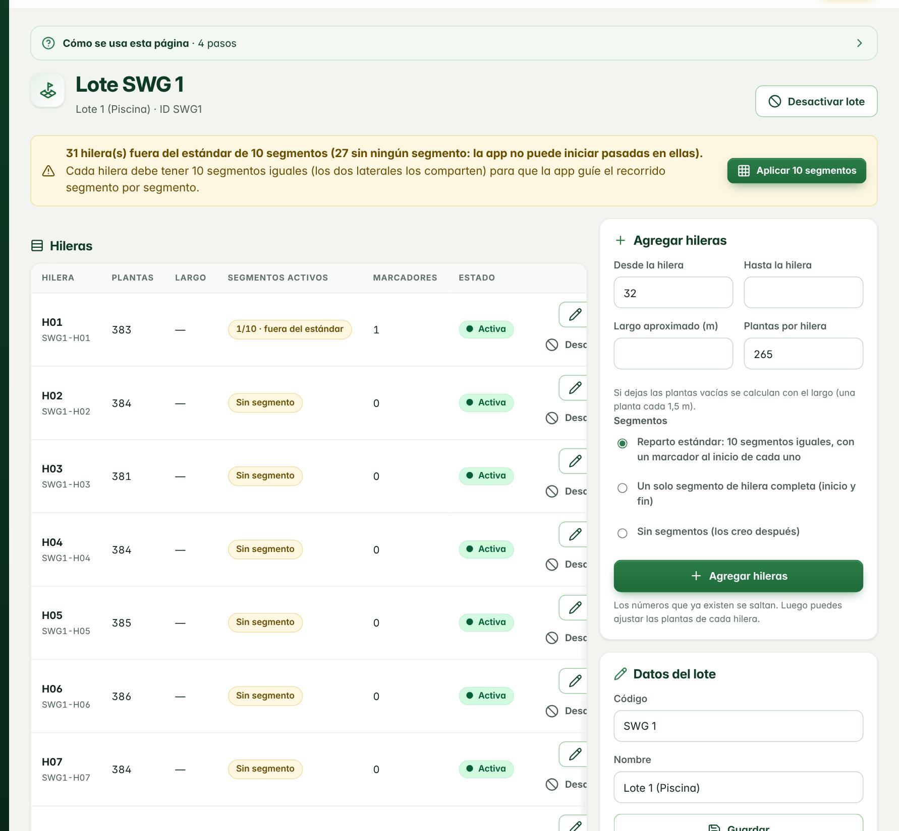

# Detalle de un lote (hileras)



| Dato | Valor |
|---|---|
| Archivo | `03-manuales/media/web/p35-72.jpeg` |
| Documento | Manual de usuario · Plataforma web (v1.6.1) |
| Sección | Catálogos del fundo (línea 1971 del manual) |
| Tipo | Captura de pantalla de la plataforma web |

## Qué muestra

Ficha del lote SWG 1: aviso amarillo de hileras fuera del estándar de 10 segmentos con el botón «Aplicar 10 segmentos», tabla de hileras (plantas, largo, segmentos, marcadores, estado, editar/desactivar) y formularios para agregar hileras y editar los datos del lote.

## Texto visible

Cómo se usa esta página · 4 pasos · Lote SWG 1 · Lote 1 (Piscina) · ID SWG1 · [Desactivar lote] · 31 hilera(s) fuera del estándar de 10 segmentos (27 sin ningún segmento: la app no puede iniciar pasadas en ellas). Cada hilera debe tener 10 segmentos iguales (los dos laterales los comparten) para que la app guíe el recorrido segmento por segmento. [Aplicar 10 segmentos] · Hileras: HILERA · PLANTAS · LARGO · SEGMENTOS ACTIVOS · MARCADORES · ESTADO · H01 SWG1-H01 · 383 · — · 1/10 · fuera del estándar · 1 · Activa · H02 · 384 · Sin segmento · 0 · Activa · (H03–H07 iguales, 381–386 plantas) · Agregar hileras: Desde la hilera 32 · Hasta la hilera · Largo aproximado (m) · Plantas por hilera 265 · Si dejas las plantas vacías se calculan con el largo (una planta cada 1,5 m). · Segmentos: ◉ Reparto estándar: 10 segmentos iguales, con un marcador al inicio de cada uno · ○ Un solo segmento de hilera completa (inicio y fin) · ○ Sin segmentos (los creo después) · [Agregar hileras] · Los números que ya existen se saltan. · Datos del lote: Código SWG 1 · Nombre Lote 1 (Piscina) · [Guardar]

<details><summary>Texto reconocido automáticamente (OCR, sin corregir)</summary>

```text
() Cómo se usa esta página - 4 pasos 2
Lote SWG 1
S ote SWG O Desactivar lote
Lote 1 (Piscina) - ID SWG1
31 hilera(s) fuera del estándar de 10 segmentos (27 sin ningún segmento: la app no puede iniciar pasadas en ellas).
A Cada hilera debe tener 10 segmentos iguales (los dos laterales los comparten) para que la app guíe el recorrido EH Aplicar 10 segmentos
segmento por segmento.
8 Hileras + Agregar hileras
Desde la hilera Hasta la hilera
HILERA PLANTAS LARGO SEGMENTOS ACTIVOS MARCADORES ESTADO
HO1 ; a L imad Plant hil
383 = 1/10 + fuera del estándar 1 0 Activa argo aproximado (m) 'antas por hilera
SWG1-HO1
(O Desc
265
HO2 = = eS Si dejas las plantas vacías se calculan con el largo (una
SS WGI-HOS 384 — Sin segmento 0 0 Activa planta cada 1,5 m).
O Desc Segmentos
(O) Reparto estándar: 10 segmentos iguales, con
LP un marcador al inicio de cada uno
HO3 s .
381 — Sin segmento 0 0 Activa
SWG1-H03 Q Desc O Un solo segmento de hilera completa (inicio y
fin)
LP O Sin segmentos (los creo después)
HO4 384 — Sin segmento 10] 0 Activa
SWG1-HO4
(O Desc
+ Agregar hileras
74 Los números que ya existen se saltan. Luego puedes
HO5 385 as Sin segmento O O Activa ajustar las plantas de cada hilera.
SWG1-HO5
(O Desc
P (4 Datos del lote
HOG6 386 Sin segmento 0 0 Activa ádi
SWG1-HO6 Spalgo
(O Desc
SWG 1
HO7 P Nombre
384 _ Sin segmento 10) O Activa
SWG1-HO7
O Desc Lote 1 (Piscina)
A EA Mcicotia:
```

</details>
