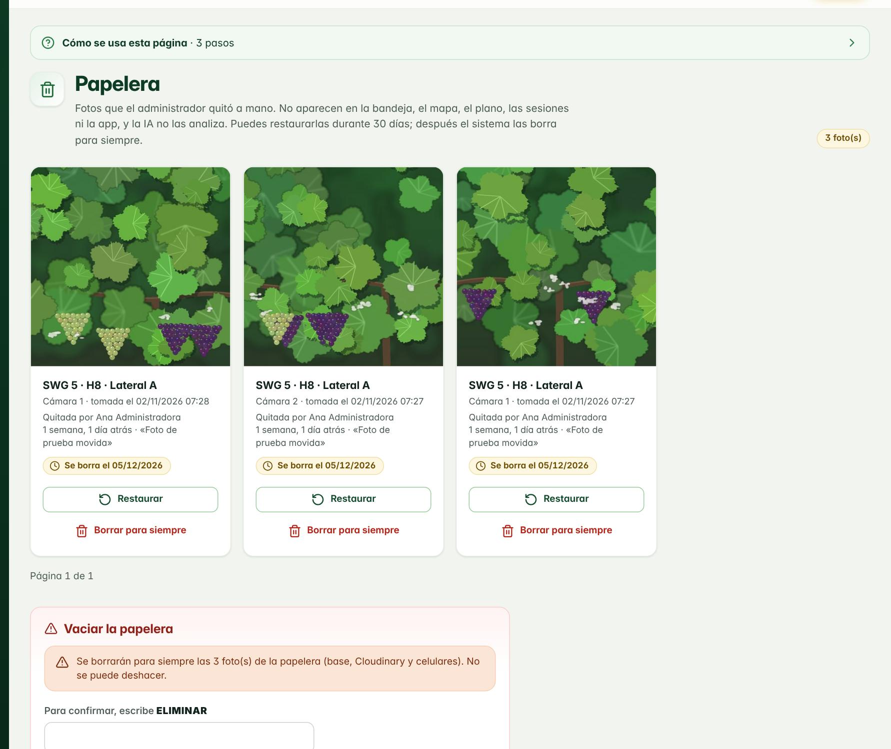

# Papelera



| Dato | Valor |
|---|---|
| Archivo | `03-manuales/media/web/p36-75.jpeg` |
| Documento | Manual de usuario · Plataforma web (v1.6.1) |
| Sección | Papelera y limpieza de fotos (línea 2015 del manual) |
| Tipo | Captura de pantalla de la plataforma web |

## Qué muestra

Fotos quitadas a mano por el administrador. Cada tarjeta indica de dónde es la foto, quién la quitó, cuándo y la fecha en que se borrará sola (30 días), con «Restaurar» y «Borrar para siempre». Abajo, la zona para vaciar la papelera, que pide escribir ELIMINAR.

## Texto visible

Cómo se usa esta página · 3 pasos · Papelera · Fotos que el administrador quitó a mano. No aparecen en la bandeja, el mapa, el plano, las sesiones ni la app, y la IA no las analiza. Puedes restaurarlas durante 30 días; después el sistema las borra para siempre. · 3 foto(s) · SWG 5 · H8 · Lateral A · Cámara 1 · tomada el 02/11/2026 07:28 · Quitada por Ana Administradora · 1 semana, 1 día atrás · «Foto de prueba movida» · Se borra el 05/12/2026 · [Restaurar] · Borrar para siempre · (2 tarjetas más iguales) · Página 1 de 1 · Vaciar la papelera · Se borrarán para siempre las 3 foto(s) de la papelera (base, Cloudinary y celulares). No se puede deshacer. · Para confirmar, escribe ELIMINAR

<details><summary>Texto reconocido automáticamente (OCR, sin corregir)</summary>

```text
() Cómo se usa esta página - 3 pasos
íú Papelera
Fotos que el administrador quitó a mano. No aparecen en la bandeja, el mapa, el plano, las sesiones
ni la app, y la IA no las analiza. Puedes restaurarlas durante 30 días; después el sistema las borra
para siempre.
SWG 5 - H8 - Lateral A
Cámara 1 - tomada el 02/11/2026 07:28
Quitada por Ana Administradora
1 semana, 1 día atrás - «Foto de
prueba movida»
(O) Se borra el 05/12/2026
O Restaurar
ij Borrar para siempre
Página 1 de 1
A Vaciar la papelera
SWG 5 - H8 - Lateral A
Cámara 2 - tomada el 02/11/2026 07:27
Quitada por Ana Administradora
1 semana, 1 día atrás - «Foto de
prueba movida»
(O Se borra el 05/12/2026
O Restaurar
(ij Borrar para siempre
SWG 5 - H8 - Lateral A
Cámara 1 + tomada el 02/11/2026 07:27
Quitada por Ana Administradora
1 semana, 1 día atrás - «Foto de
prueba movida»
(O) Se borra el 05/12/2026
O Restaurar
(ij Borrar para siempre
AA Se borrarán para siempre las 3 foto(s) de la papelera (base, Cloudinary y celulares). No
se puede deshacer.
Para confirmar, escribe ELIMINAR
```

</details>
