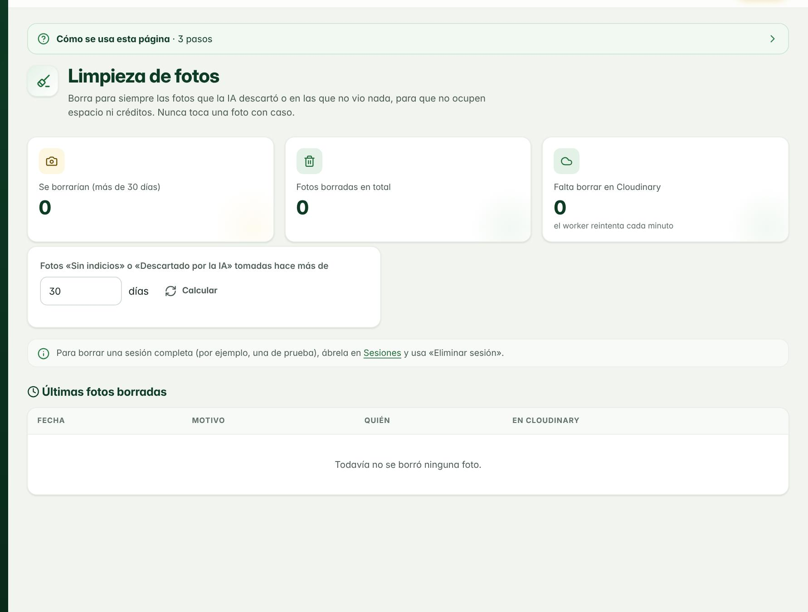

# Limpieza de fotos



| Dato | Valor |
|---|---|
| Archivo | `03-manuales/media/web/p37-77.jpeg` |
| Documento | Manual de usuario · Plataforma web (v1.6.1) |
| Sección | Limpieza de fotos (línea 2057 del manual) |
| Tipo | Captura de pantalla de la plataforma web |

## Qué muestra

Herramienta para borrar fotos sin valor (sin indicios o descartadas por la IA) pasado cierto número de días, para ahorrar espacio. Nunca toca una foto con caso. Muestra contadores y el historial de borrados.

## Texto visible

Cómo se usa esta página · 3 pasos · Limpieza de fotos · Borra para siempre las fotos que la IA descartó o en las que no vio nada, para que no ocupen espacio ni créditos. Nunca toca una foto con caso. · Se borrarían (más de 30 días) 0 · Fotos borradas en total 0 · Falta borrar en Cloudinary 0 · el worker reintenta cada minuto · Fotos «Sin indicios» o «Descartado por la IA» tomadas hace más de [30] días · Calcular · ⓘ Para borrar una sesión completa (por ejemplo, una de prueba), ábrela en Sesiones y usa «Eliminar sesión». · Últimas fotos borradas: FECHA · MOTIVO · QUIÉN · EN CLOUDINARY · Todavía no se borró ninguna foto.

<details><summary>Texto reconocido automáticamente (OCR, sin corregir)</summary>

```text
() Cómo se usa esta página - 3 pasos
sy Limpieza de fotos
Borra para siempre las fotos que la IA descartó o en las que no vio nada, para que no ocupen
espacio ni créditos. Nunca toca una foto con caso.
[1] po] S
Se borrarían (más de 30 días) Fotos borradas en total Falta borrar en Cloudinary
0 0 0
el worker reintenta cada minuto
Fotos «Sin indicios» o «Descartado por la lA» tomadas hace más de
30 días  (£ Calcular
10) Para borrar una sesión completa (por ejemplo, una de prueba), ábrela en Sesiones y usa «Eliminar sesión».
(O Últimas fotos borradas
FECHA MOTIVO QUIÉN EN CLOUDINARY
Todavía no se borró ninguna foto.
```

</details>
