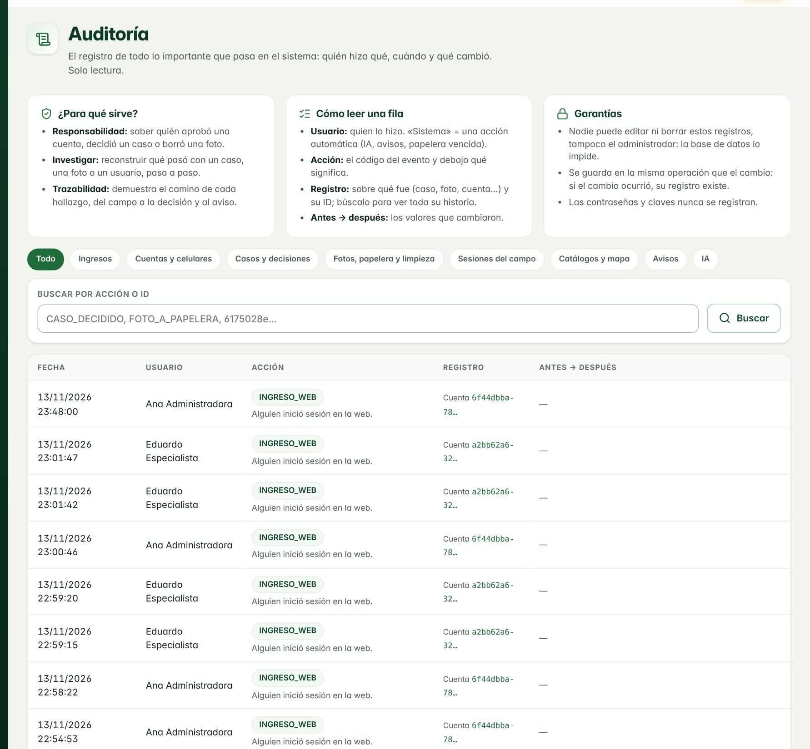

# Auditoría



| Dato | Valor |
|---|---|
| Archivo | `03-manuales/media/web/p39-80.jpeg` |
| Documento | Manual de usuario · Plataforma web (v1.6.1) |
| Sección | Auditoría (línea 2139 del manual) |
| Tipo | Captura de pantalla de la plataforma web |

## Qué muestra

Registro de solo lectura de las acciones importantes del sistema. Arriba tres recuadros explican para qué sirve, cómo leer una fila y qué garantiza; luego filtros por tipo, buscador por acción o ID y la tabla de eventos (en el ejemplo, ingresos a la web).

## Texto visible

Auditoría · El registro de todo lo importante que pasa en el sistema: quién hizo qué, cuándo y qué cambió. Solo lectura. · ¿Para qué sirve? Responsabilidad · Investigar · Trazabilidad · Cómo leer una fila: Usuario («Sistema» = acción automática) · Acción · Registro · Antes → después · Garantías: Nadie puede editar ni borrar estos registros, tampoco el administrador · Se guarda en la misma operación que el cambio · Las contraseñas y claves nunca se registran · Filtros: Todo · Ingresos · Cuentas y celulares · Casos y decisiones · Fotos, papelera y limpieza · Sesiones del campo · Catálogos y mapa · Avisos · IA · BUSCAR POR ACCIÓN O ID [CASO_DECIDIDO, FOTO_A_PAPELERA, 6175028e…] [Buscar] · Columnas: FECHA · USUARIO · ACCIÓN · REGISTRO · ANTES → DESPUÉS · 13/11/2026 23:48:00 · Ana Administradora · INGRESO_WEB · Alguien inició sesión en la web. · Cuenta 6f44dbba-… · (más filas INGRESO_WEB de Ana Administradora y Eduardo Especialista)

<details><summary>Texto reconocido automáticamente (OCR, sin corregir)</summary>

```text
a, Auditoría
El registro de todo lo importante que pasa en el sistema: quién hizo qué, cuándo y qué cambió.
Solo lectura.
O ¿Para qué sirve?
+» Responsabilidad: saber quién aprobó una
cuenta, decidió un caso o borró una foto.
+» Investigar: reconstruir qué pasó con un caso,
una foto o un usuario, paso a paso.
+ Trazabilidad: demuestra el camino de cada
hallazgo, del campo a la decisión y al aviso.
Cómo leer una fila
Usuario: quien lo hizo. «Sistema» = una acción
automática (IA, avisos, papelera vencida).
Acción: el código del evento y debajo qué
significa.
Registro: sobre qué fue (caso, foto, cuenta...) y
su ID; búscalo para ver toda su historia.
() Garantías
Nadie puede editar ni borrar estos registros,
tampoco el administrador: la base de datos lo
impide.
Se guarda en la misma operación que el cambio:
si el cambio ocurrió, su registro existe.
Las contraseñas y claves nunca se registran.
+ Antes > después: los valores que cambiaron.
Cuentas y celulares Casos y decisiones Fotos, papelera y limpieza Sesiones del campo Catálogos y mapa Avisos lA
O Ingresos
BUSCAR POR ACCIÓN O ID
CASO_DECIDIDO, FOTO_A_PAPELERA, 61750288... Q Buscar
FECHA USUARIO ACCIÓN REGISTRO ANTES > DESPUÉS
INGRESO_WEB -
13/11/2026 Ana Administradora = Cuenta 6f444bba =-
23:48:00 Alguien inició sesión en la web. 78.
13/11/2026 Eduardo INGRESO_WEB Cuenta a2bb62a6-
23:01:47 Especialista Alguien inició sesión en la web. 32.
13/11/2026 Eduardo INGRESO_WEB Cuenta a2bb62a6-
23:01:42 Especialista Alguien inició sesión en la web. 32.
13/11/2026 INGRESO_WEB c 6fA4dbba-
/ + Ana Administradora Hento a =
23:00:46 Alguien inició sesión en la web. 78.
13/11/2026 Eduardo INGRESO_WEB Cuenta a2bb62a6-
22:59:20 Especialista Alguien inició sesión en la web. 32.
13/11/2026 Eduardo INGRESO_WEB Cuenta a2bb62a6- —
22:59:15 Especialista Alguien inició sesión en la web. 32.
13/11/2026 INGRESO_WEB c 6f44dbba-
! + Ana Administradora NS a
22:58:22 Alguien inició sesión en la web. 78.
13/11/2026 Ana Administrad INGRESO_WEB Cuenta 6f44dbba-
na Administradora ná
22:54:53
Alguien inició sesión en la web. 78...
```

</details>
