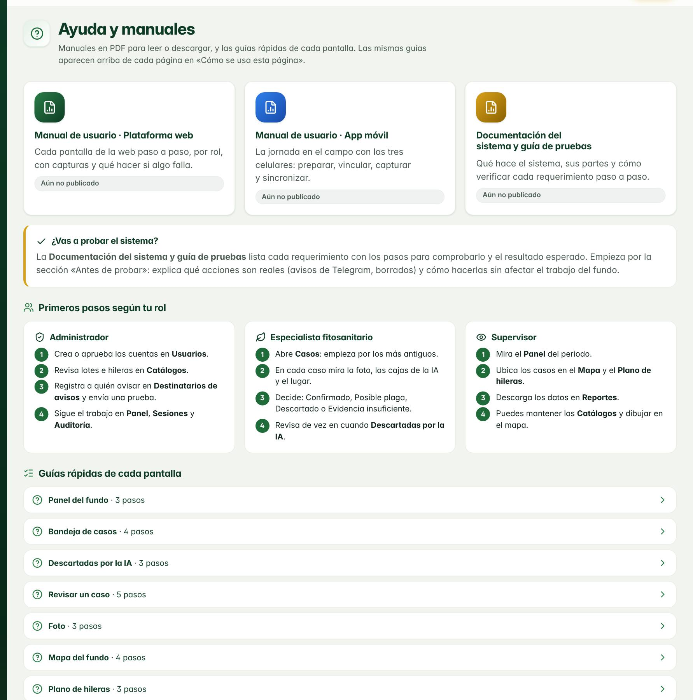

# Ayuda y manuales



| Dato | Valor |
|---|---|
| Archivo | `03-manuales/media/web/p41-83.jpeg` |
| Documento | Manual de usuario · Plataforma web (v1.6.1) |
| Sección | Ayuda, manuales y uso en el celular (línea 2221 del manual) |
| Tipo | Captura de pantalla de la plataforma web |

## Qué muestra

Pantalla de ayuda con los tres documentos (manual web, manual de la app y documentación del sistema y guía de pruebas, aún sin publicar en la captura), un aviso para quien vaya a probar el sistema, los primeros pasos por rol y la lista de guías rápidas de cada pantalla.

## Texto visible

Ayuda y manuales · Manuales en PDF para leer o descargar, y las guías rápidas de cada pantalla. Las mismas guías aparecen arriba de cada pantalla en «Cómo se usa esta página». · Manual de usuario · Plataforma web (Aún no publicado) · Manual de usuario · App móvil (Aún no publicado) · Documentación del sistema y guía de pruebas (Aún no publicado) · ¿Vas a probar el sistema? La Documentación del sistema y guía de pruebas lista cada requerimiento con los pasos para comprobarlo y el resultado esperado. Empieza por la sección «Antes de probar». · Primeros pasos según tu rol: Administrador (Usuarios → Catálogos → Destinatarios de avisos → Panel, Sesiones y Auditoría) · Especialista fitosanitario (Casos, más antiguos primero → mira foto, cajas y lugar → decide → revisa Descartadas por la IA) · Supervisor (Panel → Mapa y Plano de hileras → Reportes → Catálogos y mapa) · Guías rápidas de cada pantalla: Panel del fundo · 3 pasos · Bandeja de casos · 4 · Descartadas por la IA · 3 · Revisar un caso · 5 · Foto · 3 · Mapa del fundo · 4 · Plano de hileras · 3 · …

<details><summary>Texto reconocido automáticamente (OCR, sin corregir)</summary>

```text
E Ayuda y manuales
Manuales en PDF para leer o descargar, y las guías rápidas de cada pantalla. Las mismas guías
aparecen arriba de cada página en «Cómo se usa esta página».
Manual de usuario - Plataforma web
Cada pantalla de la web paso a paso, por rol,
con capturas y qué hacer si algo falla.
Aún no publicado
Y ¿Vas a probar el sistema?
Manual de usuario - App móvil
La jornada en el campo con los tres
celulares: preparar, vincular, capturar
y sincronizar.
Aún no publicado
Documentación del
sistema y guía de pruebas
Qué hace el sistema, sus partes y cómo
verificar cada requerimiento paso a paso.
Aún no publicado
La Documentación del sistema y guía de pruebas lista cada requerimiento con los pasos para comprobarlo y el resultado esperado. Empieza por la
sección «Antes de probar»: explica qué acciones son reales (avisos de Telegram, borrados) y cómo hacerlas sin afectar el trabajo del fundo.
2% Primeros pasos según tu rol
Administrador
Crea o aprueba las cuentas en Usuarios.
Registra a quién avisar en Destinatarios de
avisos y envía una prueba.
Sigue el trabajo en Panel, Sesiones y
Auditoría.
O Revisa lotes e hileras en Catálogos.
7= Guías rápidas de cada pantalla
() Panel del fundo - 3 pasos
(0) Bandeja de casos - 4 pasos
Descartadas por la lA - 3 pasos
Revisar un caso - 5 pasos
Foto - 3 pasos
Mapa del fundo - 4 pasos
Plano de hileras - 3 pasos
ofperyeñe"se
0 Especialista fitosanitario
Abre Casos: empieza por los más antiguos.
En cada caso mira la foto, las cajas de la IA
y el lugar.
Decide: Confirmado, Posible plaga,
Descartado o Evidencia insuficiente.
Revisa de vez en cuando Descartadas por la
lA.
O Supervisor
Mira el Panel del periodo.
Ubica los casos en el Mapa y el Plano de
hileras.
Descarga los datos en Reportes.
Puedes mantener los Catálogos y dibujar en
el mapa.
```

</details>
