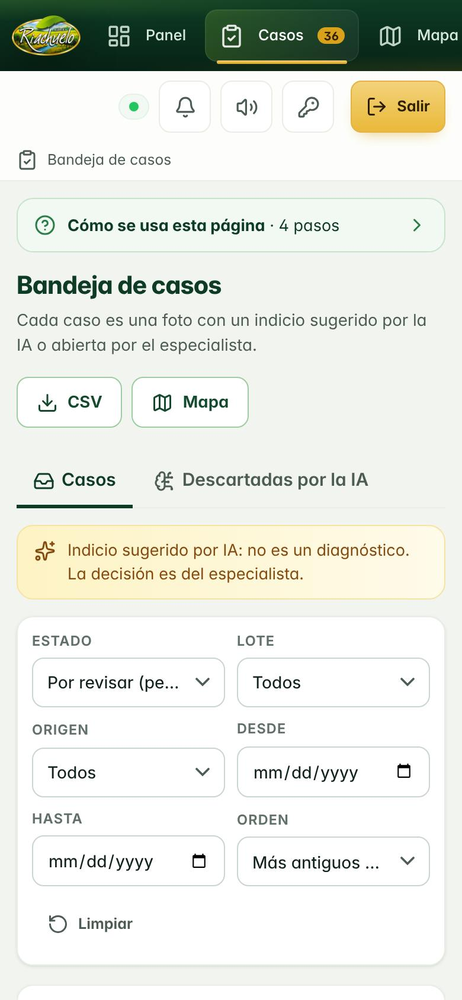

# Bandeja de casos en celular



| Dato | Valor |
|---|---|
| Archivo | `03-manuales/media/web/p42-85.jpeg` |
| Documento | Manual de usuario · Plataforma web (v1.6.1) |
| Sección | Desde el celular (línea 2243 del manual) |
| Tipo | Captura de pantalla de la plataforma web |

## Qué muestra

La bandeja vista en un navegador de celular: el menú pasa a una barra horizontal superior con logo, Panel, Casos (36) y Mapa; los filtros se acomodan en dos columnas.

## Texto visible

Panel · Casos 36 · Mapa · ● · 🔔 · 🔊 · 🔑 · [Salir] · Bandeja de casos · Cómo se usa esta página · 4 pasos · Bandeja de casos · Cada caso es una foto con un indicio sugerido por la IA o abierta por el especialista. · [CSV] [Mapa] · Casos | Descartadas por la IA · Indicio sugerido por IA: no es un diagnóstico. La decisión es del especialista. · ESTADO Por revisar (pe… · LOTE Todos · ORIGEN Todos · DESDE · HASTA · ORDEN Más antiguos … · Limpiar

<details><summary>Texto reconocido automáticamente (OCR, sin corregir)</summary>

```text
Free 05 Panel Casos
Bandeja de casos
(E) Cómo se usa esta página - 4 pasos pa
Bandeja de casos
Cada caso es una foto con un indicio sugerido por la
IA o abierta por el especialista.
Y CSsv (NW Mapa
(A Casos Q£ Descartadas por la lA
SE Indicio sugerido por lA: no es un diagnóstico.
La decisión es del especialista.
ESTADO LOTE
Por revisar (pe... Y Todos v
ORIGEN DESDE
Todos v mm/dd/yyyy [mn]
HASTA ORDEN
mm/dd/yyyy B Más antiguos ... Y
O Limpiar
```

</details>
