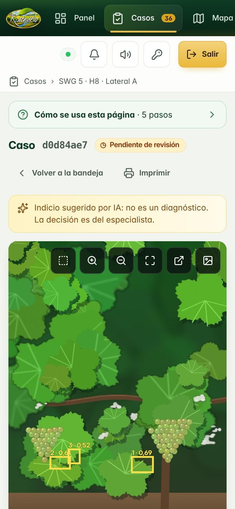

# Revisar un caso en celular



| Dato | Valor |
|---|---|
| Archivo | `03-manuales/media/web/p42-87.jpeg` |
| Documento | Manual de usuario · Plataforma web (v1.6.1) |
| Sección | Desde el celular (línea 2247 del manual) |
| Tipo | Captura de pantalla de la plataforma web |

## Qué muestra

La ficha del caso en celular: miga de pan «Casos › SWG 5 · H8 · Lateral A», el estado, el aviso de la IA y la foto a todo el ancho con sus herramientas y las cajas numeradas.

## Texto visible

Panel · Casos 36 · Mapa · [Salir] · Casos › SWG 5 · H8 · Lateral A · Cómo se usa esta página · 5 pasos · Caso d0d84ae7 · Pendiente de revisión · Volver a la bandeja · Imprimir · Indicio sugerido por IA: no es un diagnóstico. La decisión es del especialista. · [foto con cajas «1 · 0,69», «2 · 0,6…», «3 · 0,52»]

<details><summary>Texto reconocido automáticamente (OCR, sin corregir)</summary>

```text
GUEY) 05 Panel Casos (MW Mapa
Casos > SWG5 : H8 : Lateral A
(E) Cómo se usa esta página - 5 pasos
Caso d0d84ae7 0 Pendiente de revisión
< Volver a la bandeja == Imprimir
E Indicio sugerido por lA: no es un diagnóstico.
La decisión es del especialista.
```

</details>
